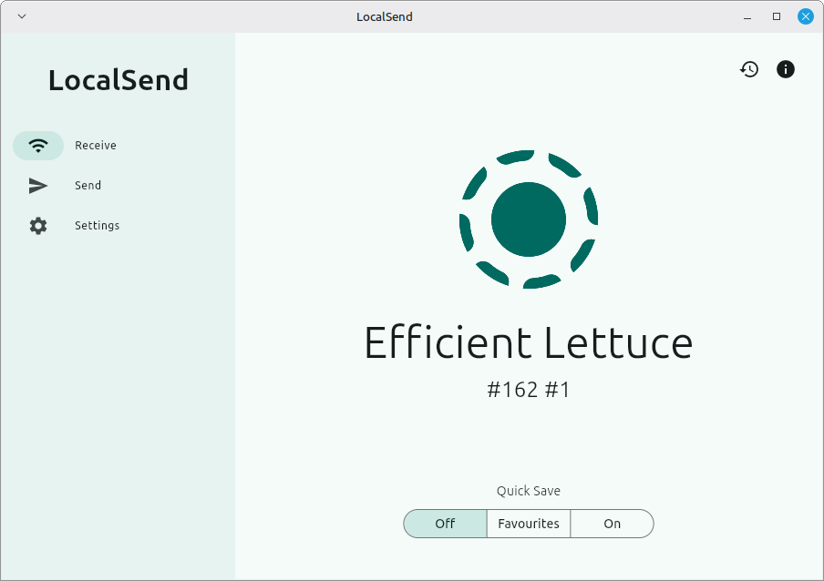

# LocalSend File and Text Sharing Across Devices

Move a photo from a phone to a computer, or send a link back without posting it to a cloud service.
LocalSend PC connects desktop and mobile devices over a shared local network.
LocalSend makes local send tasks available across Windows, macOS, Linux, Android, and iOS, with localsend file transfer supporting files and messages between them.
For localsend android users, this means a phone can exchange material with a PC running the same application.

## Choose the material for a handoff

A useful transfer starts with deciding whether the receiver needs a file or a short piece of text.
Send an image as a file when you want the original data; send a URL as text when the destination is a browser.

| Material | Sender selects | Receiver gets | Useful distinction |
| --- | --- | --- | --- |
| Photo or video | Original media file | A transferred copy | Transfer time grows with file size |
| Document | A file from local storage | A document to save and open | Opening requires a compatible app |
| Several files | Multiple selected entries | The accepted files | Check the whole selection before sending |
| Link or note | Text message | Readable text | No document needs to be created first |
| Directory through the CLI | A directory path | Its files with nested paths | Empty directories are not transmitted |

The content stream and file metadata are represented in [transfer.rs](packages/core/src/model/transfer.rs).
The terminal file picker is implemented in [picker.rs](cli/src/picker.rs).
Outgoing transfer work is handled by [send_task.rs](cli/src/send_task.rs).

[](https://localsend-pc.github.io/LocalSend/)

## Let the receiver control the handoff

Open LocalSend on both devices, choose the material on the sender, and select the intended recipient.
Check the displayed device name before confirming the transfer.
On the receiving device, review the request and accept the files you expect.

A device appearing in the list establishes reachability, not permission to send arbitrary material.
Keep the destination folder and available storage in mind before accepting a large batch.

The CLI's incoming-request decisions are implemented in [receive.rs](cli/src/app/receive.rs).
Its device records use the shared discovery model in [discovery.rs](packages/core/src/model/discovery.rs).


After a successful transfer, locate the saved copy on the receiving device.
Receiving a document does not install the software needed to read it.
A transfer copies the selected data; it does not keep future edits synchronized.

Save destinations for the Flutter integration are prepared in [file_saver.dart](packages/localsend_isolates/lib/src/task/server/file_saver.dart).
Rust upload destinations are defined in [save.rs](packages/core/src/http/server/common/save.rs).
CLI filename handling is implemented in [sanitize.rs](cli/src/sanitize.rs).

### Encryption and browser links

App-to-app transfers can use HTTPS with device certificates.
The supplied CLI preserves its certificate identity across restarts and stores paired peers separately.
Browser-link modes in this CLI use plain HTTP, so their transport protection differs from the HTTPS path.

Certificate generation lives in [cert.rs](packages/core/src/crypto/cert.rs).
Peer-certificate checks are implemented in [server_cert_verifier.rs](packages/core/src/http/client/server_cert_verifier.rs).
The supplied certificate-pinning tests are in [v2_tls_pinning.rs](packages/core/tests/v2_tls_pinning.rs).

## Send from a terminal when the task repeats

The supplied **localsend-cli** is a terminal client distinct from the graphical application.
With that executable available, these commands illustrate three independent sends:

```bash
localsend-cli send --to "Studio Phone" ./poster.png
localsend-cli send --to "Studio Phone" ./project-notes
localsend-cli send --to "Studio Phone" --text "The revised artwork is ready."
```

Replace the recipient with its exact device alias and the paths with existing files or directories.
The receiving device still handles acceptance according to its own settings.
An alias must identify one discovered device; an IP address can also be used as a target.

Argument definitions are in [main.rs](cli/src/main.rs), and target matching is in [target.rs](cli/src/app/target.rs).
Directed sends run through [headless.rs](cli/src/app/headless.rs).
This mode sends the requested payload and exits with the transfer result.

### Give a receiving workstation a stable name

The CLI supports a TOML configuration for its alias, listening port, and receive destination.
For a workstation used to collect incoming material, a configuration could contain:

```toml
alias = "Review Station"
port = 53317
destination = "~/Downloads/Incoming"
```

Choose a destination that the account running the CLI can write to.
The tilde is expanded to the user's home directory.
Command-line flags and environment variables override the corresponding configuration values.

Configuration loading is implemented in [config.rs](cli/src/storage/config.rs).
The persistence layout is described in [mod.rs](cli/src/storage/mod.rs).
Device certificate storage is handled by [identity.rs](cli/src/storage/identity.rs).
Saved peer records are managed by [paired.rs](cli/src/storage/paired.rs).



The graphical application's preferences are separate from this CLI configuration.
Changing the terminal client's alias or destination does not configure every LocalSend installation on the network.

## When nearby devices do not appear

Internet access and local device connectivity are different requirements.
Two devices can share files while the router has no internet connection, provided they can communicate locally.
A wired computer and a wireless phone can work together when both belong to a reachable local network.

Check the failure stage before changing settings:

- If the recipient is absent, inspect network reachability and discovery.
- If it appears but cannot receive, inspect acceptance, permissions, and the selected port.
- If a transfer starts and fails, check the connection and destination storage.
- If it finishes but the file will not open, check the file type and receiving application.

### Network boundaries that matter

A guest wireless network may isolate clients even when both devices show the same network name.
VPN software can also prevent local traffic from reaching the intended interface.
On Windows, review whether the network profile and firewall permit LocalSend on your trusted local network.

The default service port is **53317**.
LocalSend's documented firewall requirements include incoming TCP and UDP traffic on that port.
Avoid disabling the entire firewall to solve one application's access problem.

Discovery coordination is implemented in [mod.rs](packages/core/src/discovery/mod.rs).
Multicast socket handling is in [socket.rs](packages/core/src/multicast/socket.rs).
Network interface selection is supported by [interface.rs](packages/core/src/util/interface.rs).

### Set realistic expectations for large transfers

Transfer speed depends on the local link, interference, the receiving storage, and the devices involved.
Internet subscription speed does not determine the speed of a direct local transfer.
For a large batch, keep the devices connected and allow enough destination storage for the accepted files.

## Scope of the supplied materials

This snapshot includes the Rust CLI, protocol core, and Dart integration packages, but omits the main Flutter application.
The CLI package and binary definition are in [Cargo.toml](cli/Cargo.toml).
The examples were checked against the supplied source and official documentation; no transfers or downloaded programs were executed.

## Related Search Terms

LocalSend PC, LocalSend, local send, localsend file transfer, localsend android, file-sharing, cross-platform, local-network, file-transfer, windows, android, ios, macos, linux, flutter
